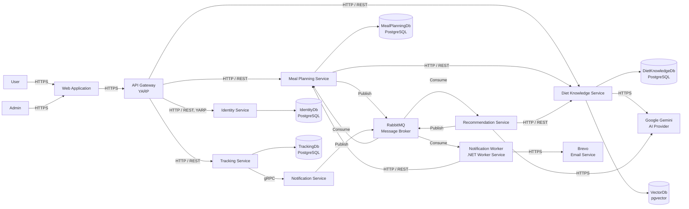

# C1 - Internal Architecture

Meal Planning calls the Diet Knowledge public APIs over HTTP to read the recipe and food catalog. Recommendation Service calls the Diet Knowledge public APIs (`/api/knowledge/search`, `/api/diet-guidelines`, `/api/foods`, `/api/recipes`) over HTTP without a JWT, so it only ever sees `Approved` content.

Recommendation Service and Notification Service are stateless in the current scope and do not own databases.

Meal Planning saves reminder and recommendation messages to an outbox table in the same transaction as the data change, and a background dispatcher publishes them to RabbitMQ, so a broker outage cannot lose them. Before it sends a delayed reminder, Notification Worker asks Meal Planning over an internal HTTP endpoint (shared key, blocked by the gateway) whether the meal plan item still exists with that reminder time. Diet Knowledge Service may call Gemini only for Admin book-source candidate extraction; public user and recommendation flows still rely on approved Diet Knowledge content.

`VectorDb` (PostgreSQL with the pgvector extension, its own container) holds embeddings of active `Approved` guidelines, foods and recipes. Diet Knowledge Service owns it and writes it after startup and on Admin rebuild; other services reach it only through the Diet Knowledge public search API (Recommendation Service uses it to rank approved knowledge by the user's preferences). Embeddings come from Google Gemini when enabled, otherwise from a local fallback.

Local Docker demo ports use HTTP on localhost, but the intended external client-to-platform boundary remains HTTPS in the architecture.
