# Conceptual ERD

```mermaid
erDiagram
    USER {
        guid Id
        string Email
        string DisplayName
    }

    ROLE {
        guid Id
        string Name
    }

    DIET_GUIDELINE {
        guid Id
        string Title
        string Summary
        string SourceNote
        string SourceTitle
        string SourceChapter
        string SourcePage
        string SourceReference
        string ReviewStatus
        string ReviewedBy
        bool IsActive
    }

    FOOD {
        guid Id
        string Name
        string Category
        string CompatibilityNotes
        string SourceTitle
        string SourceChapter
        string SourcePage
        string SourceReference
        string ReviewStatus
        string ReviewedBy
        bool IsActive
    }

    RECIPE {
        guid Id
        string Name
        string Description
        string SourceTitle
        string SourceChapter
        string SourcePage
        string SourceReference
        string ReviewStatus
        string ReviewedBy
        bool IsActive
    }

    RECIPE_INGREDIENT {
        guid Id
        guid RecipeId
        guid FoodId
        string QuantityText
    }

    BOOK_SOURCE_DOCUMENT {
        guid Id
        string OriginalFileName
        string StoredFileName
        string ContentType
        long FileSizeBytes
        string StoragePath
        string Status
        string UploadedBy
        datetime UploadedAtUtc
        datetime ProcessedAtUtc
        int ChunkCount
        string ErrorMessage
    }

    BOOK_SOURCE_CHUNK {
        guid Id
        guid DocumentId
        int ChunkIndex
        int PageNumber
        string Text
        int CharacterCount
        int TokenEstimate
        datetime CreatedAtUtc
    }

    KNOWLEDGE_CANDIDATE {
        guid Id
        guid DocumentId
        guid ChunkId
        string CandidateType
        string Title
        string Summary
        string SourceTitle
        string SourceChapter
        string SourcePage
        string SourceReference
        string Status
        string GeneratedBy
        datetime CreatedAtUtc
        string ReviewedBy
        datetime ReviewedAtUtc
        guid ApprovedKnowledgeId
    }

    MEAL_PLAN {
        guid Id
        guid UserId
        string Name
        date StartDate
        date EndDate
        datetime CreatedAtUtc
        datetime UpdatedAtUtc
    }

    MEAL_PLAN_ITEM {
        guid Id
        guid MealPlanId
        guid RecipeId
        guid FoodId
        date PlannedDate
        string MealSlot
        string Notes
        datetime ReminderAtUtc
    }

    MEAL_RECOMMENDATION_REQUEST {
        guid Id
        guid UserId
        string PreferenceTagsJson
        int Days
        string Status
        string SuggestedMealTitlesJson
        string Disclaimer
        guid AcceptedMealPlanId
        datetime RequestedAtUtc
        datetime CompletedAtUtc
        datetime UpdatedAtUtc
    }

    DAILY_TRACKING {
        guid Id
        guid UserId
        date TrackingDate
        string Notes
        datetime CreatedAtUtc
        datetime UpdatedAtUtc
    }

    MEAL_TRACKING {
        guid Id
        guid DailyTrackingId
        guid MealPlanItemId
        bool IsCompleted
        datetime CompletedAtUtc
        datetime CreatedAtUtc
        datetime UpdatedAtUtc
    }

    PROGRESS_SUMMARY {
        guid Id
        guid UserId
        date PeriodStartDate
        date PeriodEndDate
        int PlannedMeals
        int CompletedMeals
        datetime CalculatedAtUtc
        guid LastNotificationId
        datetime LastNotificationSentAtUtc
    }

    USER_PROFILE {
        guid Id
        guid UserId
        string PreferenceTags
        string Notes
        datetime UpdatedAtUtc
    }

    CATEGORY {
        guid Id
        string Name
        string CategoryType
        string Description
        bool IsActive
    }

    NUTRITION_FACT {
        guid Id
        guid FoodId
        string ServingSize
        decimal EnergyKcal
        decimal ProteinG
        decimal CarbohydrateG
        decimal FatG
        decimal FiberG
        string SourceReference
    }

    RECIPE_STEP {
        guid Id
        guid RecipeId
        int StepNumber
        string Instruction
    }

    DIET_REGIMEN {
        guid Id
        string Name
        string Description
        int DurationDays
        string SourceReference
        string ReviewStatus
        bool IsActive
    }

    DIET_REGIMEN_GUIDELINE {
        guid Id
        guid DietRegimenId
        guid GuidelineId
        int SortOrder
        string Note
    }

    DIET_REGIMEN_MEAL {
        guid Id
        guid DietRegimenId
        guid RecipeId
        int DayNumber
        string MealSlot
        string Notes
    }

    USER_DIET_TRACKING {
        guid Id
        guid UserId
        guid DietRegimenId
        guid MealPlanId
        date StartDate
        date EndDate
        string Status
    }

    KNOWLEDGE_EMBEDDING {
        guid Id
        guid IndexRunId
        string SourceType
        guid SourceId
        string ContentHash
        string Content
        vector Embedding
        string EmbeddingModel
    }

    EMBEDDING_INDEX_RUN {
        guid Id
        datetime StartedAtUtc
        datetime CompletedAtUtc
        int ItemsIndexed
        int ItemsFailed
        string Status
    }

    USER }o--o{ ROLE : has
    USER ||--o| USER_PROFILE : has
    CATEGORY ||--o{ FOOD : groups
    CATEGORY ||--o{ RECIPE : groups
    CATEGORY ||--o{ DIET_GUIDELINE : groups
    FOOD ||--o{ NUTRITION_FACT : described_by
    RECIPE ||--o{ RECIPE_STEP : has
    DIET_REGIMEN ||--o{ DIET_REGIMEN_GUIDELINE : applies
    DIET_GUIDELINE ||--o{ DIET_REGIMEN_GUIDELINE : used_by
    DIET_REGIMEN ||--o{ DIET_REGIMEN_MEAL : schedules
    RECIPE ||--o{ DIET_REGIMEN_MEAL : served_in
    USER_DIET_TRACKING ||--o{ DAILY_TRACKING : has
    USER_DIET_TRACKING ||--o{ PROGRESS_SUMMARY : summarizes
    EMBEDDING_INDEX_RUN ||--o{ KNOWLEDGE_EMBEDDING : produced
    RECIPE ||--o{ RECIPE_INGREDIENT : contains
    FOOD ||--o{ RECIPE_INGREDIENT : used_by
    BOOK_SOURCE_DOCUMENT ||--o{ BOOK_SOURCE_CHUNK : extracted_into
    BOOK_SOURCE_DOCUMENT ||--o{ KNOWLEDGE_CANDIDATE : generates
    BOOK_SOURCE_CHUNK ||--o{ KNOWLEDGE_CANDIDATE : supports
    MEAL_PLAN ||--o{ MEAL_PLAN_ITEM : contains
    DAILY_TRACKING ||--o{ MEAL_TRACKING : records
```

Cross-service relationships such as `MealPlan.UserId`, `MealPlanItem.RecipeId`, `MealPlanItem.FoodId`, and `MealTracking.MealPlanItemId` are ID references only, not cross-database foreign keys.

Meal scheduling is represented by `MealPlanItem.PlannedDate`, `MealSlot`, and `ReminderAtUtc` rather than a separate `MealSchedule` table in the current workflow.

Book-source tables are internal to Diet Knowledge review. `KnowledgeCandidate.ApprovedKnowledgeId` stores the created guideline/food identifier after approval but is not modeled as a foreign key because candidates can approve into more than one managed content type. `KnowledgeCandidate.IngredientsJson` holds a Recipe candidate's ingredients (name and quantity exactly as the book states them) until approval turns them into `RecipeIngredient` rows.

Recommendation Service and Notification Service are stateless in the current scope, so they do not appear as database entities.

## Revised design (lecturer feedback)

The lecturer asked for more modules and a separate vector database. All of it is implemented: `USER_PROFILE`, `CATEGORY`, `NUTRITION_FACT`, `RECIPE_STEP`, `DIET_REGIMEN`, `DIET_REGIMEN_GUIDELINE`, `DIET_REGIMEN_MEAL`, `USER_DIET_TRACKING`, and the VectorDb entities `KNOWLEDGE_EMBEDDING` and `EMBEDDING_INDEX_RUN`.

Module mapping: Module 1 User (`USER`, `ROLE`, `USER_PROFILE`), Module 2 Diet (`CATEGORY`, `RECIPE`, ingredient = `FOOD`, `RECIPE_INGREDIENT`, `RECIPE_STEP`, `NUTRITION_FACT`, `DIET_GUIDELINE`), Module 3 Diet Regimen (`DIET_REGIMEN*`), Module 4 Meal Plan, Module 5 UserDietTracking.

- `FOOD` is the "Ingredient" of the lecturer's list and keeps the name `Foods` in code. `FOOD.Category` is now a foreign key to `CATEGORY`.
- `MealPlan.DietRegimenId`, `UserDietTracking.DietRegimenId` and `UserDietTracking.MealPlanId` are ID references only.
- `USER_PROFILE.UserId` is a foreign key inside IdentityDb; `DAILY_TRACKING` and `PROGRESS_SUMMARY` have an optional `UserDietTrackingId` foreign key inside TrackingDb.
- `KNOWLEDGE_EMBEDDING` and `EMBEDDING_INDEX_RUN` live in the separate pgvector database (VectorDb). `SourceType`/`SourceId` point at an approved guideline, food or recipe in DietKnowledgeDb with no foreign key. Raw book chunks are never embedded.
